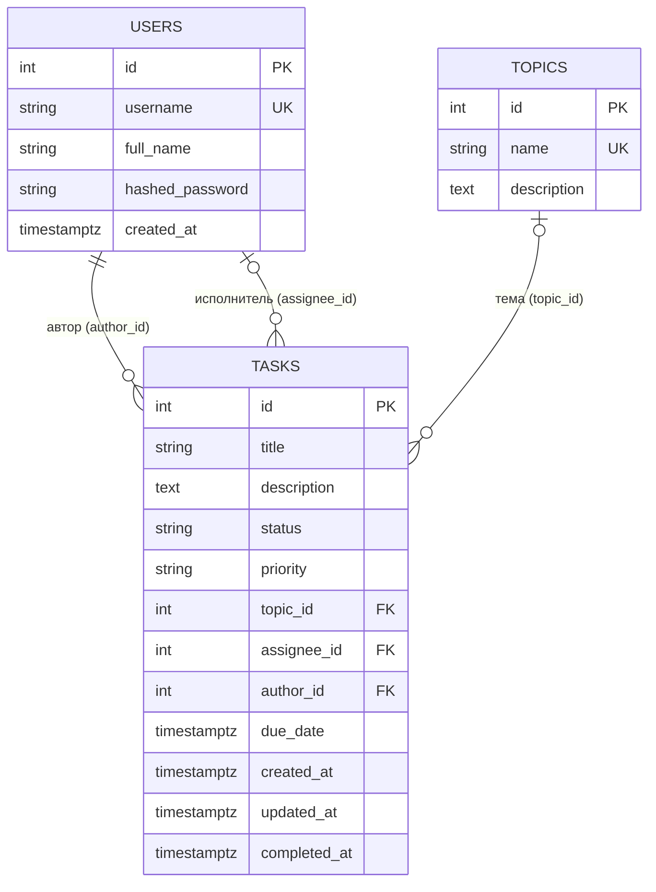
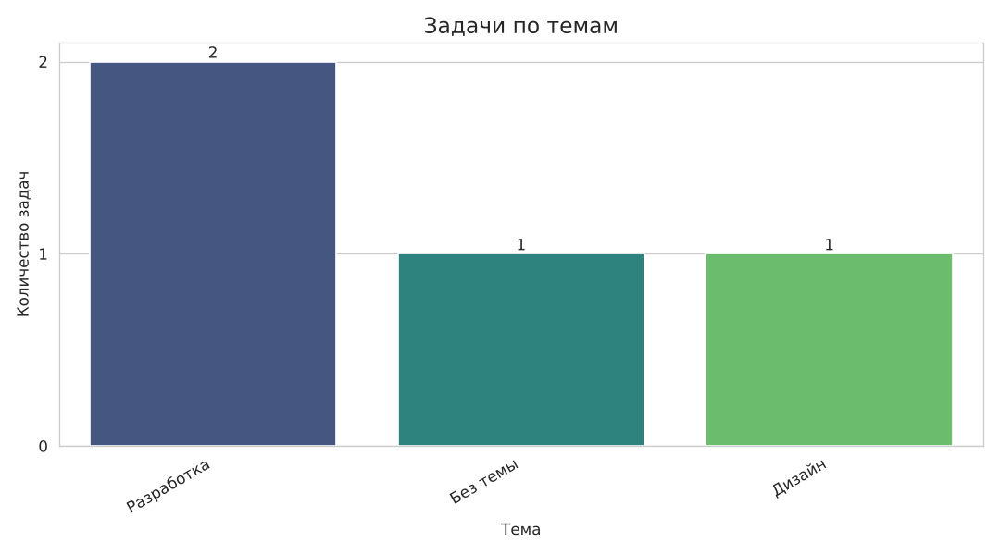

# Трекер задач

Сервис учёта задач на FastAPI + PostgreSQL: CRUD, фильтрация, смена статусов, аналитика (pandas) и графики (matplotlib/seaborn), JWT-аутентификация, миграции Alembic, тесты Pytest.

## Краткая презентация

### 1. Что умеет сервис
- Регистрация и вход, JWT-токен (`Authorization: Bearer ...`).
- CRUD задач, тем и просмотр списка пользователей.
- Список задач с фильтрами: статус, приоритет, тема, исполнитель, автор, поиск по тексту, сроки, просроченные; сортировка и пагинация.
- Смена статуса отдельным запросом: `новая` → `в работе` → `на проверке` → `выполнена` / `отменена`. При переходе в `выполнена` автоматически заполняется `completed_at`.
- Аналитика: группировка по статусу, теме и исполнителю, сводная статистика (доля выполненных, просроченные, среднее время выполнения), графики в PNG.

### 2. Модель данных (ERD)



Связи:
- пользователь является автором многих задач (`author_id`, `ON DELETE RESTRICT`);
- пользователь может быть исполнителем многих задач (`assignee_id`, `ON DELETE SET NULL`);
- тема объединяет много задач (`topic_id`, `ON DELETE SET NULL`).

Ограничения БД: `CHECK` на допустимые значения `status` (`новая`, `в работе`, `на проверке`, `выполнена`, `отменена`) и `priority` (`низкий`, `средний`, `высокий`); индексы по `status`, `topic_id`, `assignee_id`.

### 3. Архитектура

| Слой | Модуль |
|------|--------|
| Маршруты API | `app/routers/` |
| Бизнес-логика и запросы к БД | `app/crud.py` |
| Модели SQLAlchemy | `app/models.py` |
| Схемы валидации Pydantic | `app/schemas.py` |
| Аутентификация | `app/security.py`, `app/deps.py` |
| Аналитика и графики (pandas, matplotlib, seaborn) | `app/analytics.py`, `app/data.py` |
| Миграции | `migrations/` |
| Тесты | `tests/` |

### 4. Безопасность
- Пароли хранятся только в виде хэша (PBKDF2-HMAC-SHA256, случайная соль, сравнение через `hmac.compare_digest`).
- JWT с ограниченным сроком действия; все маршруты, кроме регистрации, входа и `/health`, требуют токен.
- Защита от SQL-инъекций: все запросы строятся через SQLAlchemy с параметризацией, сырой SQL с подстановкой пользовательских данных не используется.
- Параметры фильтрации и сортировки ограничены типами и перечислениями (`Enum`, `int`, `datetime`): недопустимые значения отклоняются с кодом 422.
- Поисковая строка экранируется для `LIKE` (`%`, `_`, `\`), поэтому спецсимволы ищутся как обычный текст.
- Удалить задачу может только её автор.

### 5. Аналитика

Пример графика `GET /analytics/chart?group_by=topic`:



## Быстрый старт

Требуется Python 3.11+ и Docker (для PostgreSQL).

```bash
python -m venv .venv
source .venv/bin/activate
pip install -r requirements.txt

cp .env.example .env
docker compose up -d db

alembic upgrade head
python -m scripts.seed_demo

uvicorn app.main:app --reload
```

Интерактивная документация: http://127.0.0.1:8000/docs

Демо-пользователи (после `scripts.seed_demo`): `ivanov`, `petrova`, `sidorov`, пароль `demo12345`.

## Примеры запросов

```bash
curl -X POST http://127.0.0.1:8000/auth/register \
  -H "Content-Type: application/json" \
  -d '{"username": "ivan", "full_name": "Иван Иванов", "password": "Password123"}'

TOKEN=$(curl -s -X POST http://127.0.0.1:8000/auth/login \
  -H "Content-Type: application/json" \
  -d '{"username": "ivan", "password": "Password123"}' | python -c "import sys, json; print(json.load(sys.stdin)['access_token'])")

curl -X POST http://127.0.0.1:8000/tasks \
  -H "Authorization: Bearer $TOKEN" -H "Content-Type: application/json" \
  -d '{"title": "Подготовить отчёт", "priority": "высокий"}'

curl -G http://127.0.0.1:8000/tasks \
  -H "Authorization: Bearer $TOKEN" \
  --data-urlencode "status=в работе" --data-urlencode "search=отчёт"

curl -X PATCH http://127.0.0.1:8000/tasks/1/status \
  -H "Authorization: Bearer $TOKEN" -H "Content-Type: application/json" \
  -d '{"status": "выполнена"}'

curl http://127.0.0.1:8000/analytics/summary -H "Authorization: Bearer $TOKEN"
curl "http://127.0.0.1:8000/analytics/chart?group_by=status" -H "Authorization: Bearer $TOKEN" -o chart.png
```

## Эндпоинты

| Метод | Путь | Описание |
|-------|------|----------|
| POST | `/auth/register` | Регистрация |
| POST | `/auth/login` | Получение JWT |
| GET | `/auth/me` | Текущий пользователь |
| GET | `/users` | Список пользователей |
| POST, GET | `/topics` | Создать тему, список тем |
| DELETE | `/topics/{id}` | Удалить тему (у задач тема сбрасывается) |
| POST | `/tasks` | Создать задачу |
| GET | `/tasks` | Список с фильтрами, сортировкой и пагинацией |
| GET, PUT, DELETE | `/tasks/{id}` | Получить, обновить, удалить |
| PATCH | `/tasks/{id}/status` | Изменить статус |
| GET | `/analytics/summary` | Сводная статистика |
| GET | `/analytics/group?group_by=status\|topic\|assignee` | Группировка |
| GET | `/analytics/chart?group_by=status\|topic\|assignee` | График PNG |
| GET | `/health` | Проверка работоспособности |

Параметры `GET /tasks`: `status`, `priority`, `topic_id`, `assignee_id`, `author_id`, `search`, `due_before`, `due_after`, `overdue_only`, `sort_by` (`created_at`, `updated_at`, `due_date`, `title`), `order` (`asc`, `desc`), `limit` (1–100), `offset`.

## Миграции

```bash
alembic upgrade head
alembic downgrade -1
alembic revision --autogenerate -m "описание"
```

## Тесты

```bash
pytest
```

Тесты используют in-memory SQLite и переопределяют зависимость `get_db`, поэтому PostgreSQL для них не нужен. Покрыты: аутентификация, CRUD задач и тем, фильтры, пагинация, смена статусов, защита от SQL-инъекций, аналитика и генерация графиков.

## Структура проекта

```
app/
  analytics.py   constants.py   crud.py   data.py   database.py
  config.py      deps.py        main.py   models.py schemas.py   security.py
  routers/       auth.py  users.py  topics.py  tasks.py  analytics.py
migrations/      env.py  script.py.mako  versions/0001_initial.py
scripts/         seed_demo.py
tests/           conftest.py  test_auth.py  test_tasks.py  test_analytics.py  test_analytics_unit.py
docs/            chart_example.png
```
